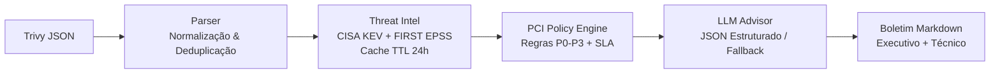

# vtx-vuln-triage-ai — Project Cookbook

Pipeline automatizado de **triagem e priorização de vulnerabilidades orientada a risco real** para ambientes **FinTech / PCI-DSS**. Combina relatórios do **Trivy**, inteligência de ameaças (**CISA KEV** e **FIRST EPSS**), motor determinístico de políticas e síntese executiva estruturada com **IA (e fallback determinístico)**.

---

## Sumário

1. [Visão Geral e Arquitetura](#1-visão-geral-e-arquitetura)
2. [Pré-requisitos e Setup](#2-pré-requisitos-e-setup)
3. [Receitas Operacionais (Cookbook)](#3-receitas-operacionais-cookbook)
4. [Estudo de Caso: Antes vs. Depois](#4-estudo-de-caso-antes-vs-depois)
5. [Governança, SLAs e Compliance](#5-governança-slas-e-compliance)
6. [Testes, Qualidade e Resiliência](#6-testes-qualidade-e-resiliência)
7. [Estrutura do Repositório](#7-estrutura-do-repositório)
8. [Troubleshooting Rápido](#8-troubleshooting-rápido)
9. [Disclaimer](#9-disclaimer)

---

## 1. Visão Geral e Arquitetura

O sistema separa rigidamente **decisão de risco** (determinística e auditável) de **comunicação executiva** (assistida por IA), garantindo reprodutibilidade para auditorias **PCI-DSS**.



**Estágios do pipeline:**
- **Ingestão (`parsers/`):** normaliza CVEs, prioriza CVSS da NVD, deduplica achados e descarta registros sem CVE válido.
- **Enriquecimento (`enrichers/`):** cruza CVEs com exploração ativa (**CISA KEV**) e probabilidade de exploração (**FIRST EPSS**) usando cache local em disco.
- **Política (`policy/`):** classifica cada vulnerabilidade de `P0` a `P3` com base em KEV, EPSS, CVSS e criticidade do ativo (`CDE`, `CONNECTED`, `STANDARD`).
- **Relatório (`reporting/`):** sintetiza ações imediatas e gera o boletim final com rastreabilidade de compliance.

---

## 2. Pré-requisitos e Setup

**Requisitos:** Python 3.11+, Docker + Docker Compose (para scans Trivy) e `python3-venv` (em ambientes Linux/WSL).

```bash
# 1. Criar e ativar ambiente virtual
python3 -m venv .venv
source .venv/bin/activate

# 2. Instalar projeto e dependências de desenvolvimento
pip install -e ".[dev]"

# 3. (Opcional) Configurar chave de LLM para síntese executiva
cp .env.example .env
```

---

## 3. Receitas Operacionais (Cookbook)

### Receita 1 — Triagem 100% Offline (CI/CD e Ambientes Isolados)
Executa sem chamadas externas (KEV, EPSS ou OpenAI), ideal para validação rápida em esteiras de build.

```bash
python -m vtx_vuln_triage.main \
  --input tests/fixtures/sample_trivy.json \
  --output data/reports/demo_offline.md \
  --criticality CDE \
  --offline
```

### Receita 2 — Triagem com Threat Intelligence ao Vivo (KEV + EPSS)
Consulta o catálogo CISA KEV e a API FIRST EPSS em lote, populando o cache local (`data/cache/`) por 24h.

```bash
python -m vtx_vuln_triage.main \
  --input tests/fixtures/sample_trivy.json \
  --output data/reports/demo_online.md \
  --criticality CDE
```

### Receita 3 — Scan Real de Container (Cenário Legado vs. Remediado)
Gera o JSON do Trivy via Docker Compose com cache persistente de banco de vulnerabilidades e executa a triagem completa.

```bash
# Cenário Legado (nginx:1.23.0 — Debian 11)
docker compose --profile legacy up
python -m vtx_vuln_triage.main \
  --input data/raw/legacy_nginx_1.23.json \
  --output data/reports/legacy_triage.md \
  --criticality CDE

# Cenário Remediado (nginx:1.27-alpine)
docker compose --profile remediated up
python -m vtx_vuln_triage.main \
  --input data/raw/remediated_nginx_1.27_alpine.json \
  --output data/reports/remediated_triage.md \
  --criticality CDE
```

### Receita 4 — Síntese Executiva com LLM (Opcional)
Quando `OPENAI_API_KEY` está definida no ambiente, o `LlmAdvisor` gera o resumo executivo em JSON estrito validado por Pydantic; se a chave estiver ausente ou a API falhar, aciona o fallback determinístico automaticamente.

```bash
export OPENAI_API_KEY="sk-sua-chave"
python -m vtx_vuln_triage.main \
  --input data/raw/remediated_nginx_1.27_alpine.json \
  --output data/reports/remediated_llm.md \
  --criticality CDE
```

### Receita 5 — Customização de Política e Criticidade do Ativo
Ajuste SLAs e thresholds em `config/pci_policy.yaml` sem alterar código, ou passe uma política alternativa via `--policy`:

```bash
python -m vtx_vuln_triage.main \
  --input data/raw/remediated_nginx_1.27_alpine.json \
  --output data/reports/standard_triage.md \
  --criticality STANDARD \
  --policy config/pci_policy.yaml
```

---

## 4. Estudo de Caso: Antes vs. Depois

Validação real em escopo **CDE (PCI-DSS)** comparando a migração estrutural de imagem base (`nginx:1.23.0` -> `nginx:1.27-alpine`):

| Métrica | Antes (`nginx:1.23.0`) | Depois (`nginx:1.27-alpine`) | Redução |
| :--- | :---: | :---: | :---: |
| **Total de achados** | 1.115 | 219 | **-80,4%** |
| **P0 (CISA KEV em PCI \| SLA 2d)** | 7 | 2 | **-71,4%** |
| **P1 (Alto Risco \| SLA 7d)** | 55 | 13 | **-76,4%** |
| **P2 (Moderado/Alto \| SLA 30d)** | 374 | 86 | **-77,0%** |
| **P3 (Baixo/Moderado \| SLA 90d)** | 679 | 118 | **-82,6%** |
| **Achados sem patch disponível** | Múltiplos (SO obsoleto) | **0 (100% corrigíveis)** | **-100%** |

- **Evidência Antes:** [`docs/evidence/legacy_nginx_1.23/triage_report.md`](docs/evidence/legacy_nginx_1.23/triage_report.md)
- **Evidência Depois:** [`docs/evidence/remediated_nginx_1.27_alpine/triage_report.md`](docs/evidence/remediated_nginx_1.27_alpine/triage_report.md)

---

## 5. Governança, SLAs e Compliance

| Prioridade | Regra de Classificação | SLA | Framework Relacionado |
| :---: | :--- | :---: | :--- |
| **P0** | CISA KEV ativa em ativo `CDE` ou `CONNECTED` | **2 dias** | PCI-DSS Req. 6.3.3 / Emergencial |
| **P1** | CISA KEV (fora do CDE), `CVSS >= 9.0` ou `EPSS >= 70%` | **7 dias** | NIST CSF `ID.RA-05` |
| **P2** | `CVSS >= 7.0` ou `EPSS >= 30%` | **30 dias** | PCI-DSS Req. 6.3.3 (Janela padrão) |
| **P3** | Demais achados sem exploração ativa | **90 dias** | CIS Control 7 (Manutenção contínua) |

Consulte a matriz completa em [`docs/compliance_mapping.md`](docs/compliance_mapping.md).

---

## 6. Testes, Qualidade e Resiliência

A suíte automatizada (`pytest`) cobre validação de contratos, parser Trivy, mocks HTTP para CISA KEV/EPSS (incluindo cache e erro 503), motor determinístico PCI-DSS e execução *end-to-end*:

```bash
# Rodar toda a suíte
pytest -v

# Rodar com relatório de cobertura
pytest --cov=vtx_vuln_triage --cov-report=term-missing
```

---

## 7. Estrutura do Repositório

```text
vtx-vuln-triage-ai/
├── config/pci_policy.yaml           # Política declarativa (SLAs, thresholds e compliance)
├── docs/
│   ├── architecture.md              # Arquitetura detalhada e ADRs
│   ├── compliance_mapping.md        # Rastreabilidade PCI-DSS, NIST CSF e CIS Controls
│   └── evidence/                    # Relatórios versionados (Antes vs. Depois)
├── src/vtx_vuln_triage/
│   ├── models.py                    # Contratos Pydantic v2
│   ├── parsers/trivy_parser.py      # Normalização e deduplicação
│   ├── enrichers/                   # Clientes CISA KEV e FIRST EPSS
│   ├── policy/pci_engine.py         # Motor determinístico P0–P3
│   ├── reporting/                   # LLM Advisor (fallback) e renderizador Markdown
│   ├── utils/cache.py               # Cache local JSON com TTL
│   └── main.py                      # CLI principal (Typer)
├── tests/                           # Testes unitários e E2E
├── docker-compose.yml               # Perfis Trivy (legacy e remediated)
└── pyproject.toml
```

---

## 8. Troubleshooting Rápido

- **`ensurepip is not available` no Ubuntu/WSL:** instale o pacote `python3.<versão>-venv` (`sudo apt update && sudo apt install -y python3-venv`), remova `.venv` e recrie o ambiente.
- **`.venv` criada no Windows usada no WSL:** ambientes virtuais não são intercambiáveis entre Windows e Linux; recrie a `.venv` dentro do WSL.
- **Scan lento no Trivy:** o `docker-compose.yml` usa `--scanners vuln` e volume `trivy-cache` para evitar baixar a base novamente após a primeira execução.
- **Falha de rede nas APIs externas:** o pipeline degrada graciosamente sem interromper a triagem; use `--offline` para ignorar consultas externas intencionalmente.

---

## 9. Disclaimer

- **Finalidade Educacional e de Portfólio:** Este projeto foi desenvolvido para fins de estudo, demonstração técnica e automação defensiva (Blue Team / AppSec).
- **Ausência de Garantia (*As-Is*):** O software é fornecido "como está", sem garantias expressas ou implícitas. Valide os resultados antes de aplicar decisões em ambientes produtivos.
- **Limites de Compliance:** O mapeamento para **PCI-DSS**, **NIST CSF** e **CIS Controls** serve como apoio operacional à gestão de vulnerabilidades e **não** substitui auditoria oficial (QSA/ASV) nem garante conformidade regulatória por si só.
- **Uso Responsável de IA:** A camada de LLM atua apenas na síntese textual; toda classificação de risco (`P0–P3`) e SLA é calculada de forma determinística pelo motor de políticas. Nunca envie dados sensíveis, credenciais ou informações de titulares de cartão para APIs externas.
- **Marcas e Fontes de Terceiros:** Trivy, CISA KEV, FIRST EPSS, PCI-DSS, NIST e CIS são marcas e iniciativas de seus respectivos detentores, sem afiliação ou endosso a este repositório.

---

## Documentação Complementar

- [Arquitetura e Decisões Técnicas (ADRs)](docs/architecture.md)
- [Mapeamento de Compliance (PCI-DSS, NIST CSF e CIS Controls)](docs/compliance_mapping.md)
