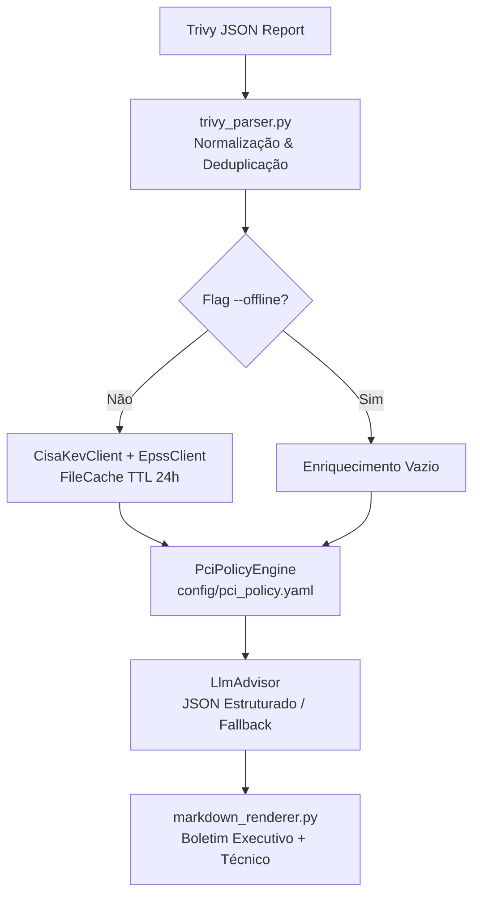

# Arquitetura e Decisões Técnicas (ADRs) — vtx-vuln-triage-ai

## 1. Visão Geral do Fluxo

O `vtx-vuln-triage-ai` transforma relatórios JSON brutos do **Trivy** em boletins priorizados e auditáveis para ambientes **FinTech / PCI-DSS**, separando rigidamente **enriquecimento externo**, **motor determinístico de risco** e **camada de síntese executiva**.

## 2. Responsabilidade dos Módulos

| Módulo | Responsabilidade | Regra / Contrato Principal |
| :--- | :--- | :--- |
| `models.py` | Contratos de dados (Pydantic v2) | Normaliza `CVE-*`, rejeita IDs inválidos e valida faixas de CVSS (`0–10`) e EPSS (`0–1`). |
| `parsers/trivy_parser.py` | Ingestão de relatórios Trivy | Prioriza CVSS da NVD, deduplica por `(cve_id, package, version, target)` e descarta não-CVEs. |
| `enrichers/cisa_kev.py` | Inteligência de exploração ativa | Consulta catálogo CISA KEV com cache em disco e degradação graciosa em erro HTTP. |
| `enrichers/epss_client.py` | Probabilidade de exploração | Consulta API FIRST EPSS em lote (`batch_size=50`) com cache individual por CVE. |
| `utils/cache.py` | Cache local JSON com TTL | Evita *rate-limit* em APIs públicas e acelera reexecuções locais. |
| `policy/pci_engine.py` | Motor determinístico (`P0`–`P3`) | Avalia KEV, EPSS, CVSS e criticidade do ativo (`CDE`, `CONNECTED`, `STANDARD`) gerando SLA e `rationale`. |
| `reporting/llm_advisor.py` | Síntese executiva | Gera resumo e ações imediatas em JSON estrito; aciona fallback determinístico sem `OPENAI_API_KEY` ou em falha de rede. |
| `reporting/markdown_renderer.py` | Renderização do boletim | Consolida métricas, tabela priorizada e referências de compliance em Markdown. |
| `main.py` | Interface CLI (Typer) | Orquestra o pipeline completo com suporte a `--criticality`, `--policy` e `--offline`. |

## 3. Decisões Arquiteturais (ADRs)

### ADR-01: Motor de Decisão Determinístico Desacoplado da IA
- **Decisão:** A classificação de prioridade (`P0`–`P3`) e a atribuição de SLA (`2d`, `7d`, `30d`, `90d`) são executadas exclusivamente por código determinístico (`pci_engine.py`) guiado por `config/pci_policy.yaml`, nunca delegadas ao LLM.
- **Justificativa:** Em auditorias **PCI-DSS**, decisões de prazo e risco precisam ser reproduzíveis, rastreáveis e livres de alucinação. A IA atua apenas na síntese executiva.

### ADR-02: Resiliência, Cache Local e Modo Offline
- **Decisão:** Falhas de rede nos feeds externos (CISA KEV, FIRST EPSS, OpenAI) não interrompem a triagem; a flag `--offline` permite execução 100% isolada em esteiras CI/CD.
- **Justificativa:** Evita que indisponibilidades de terceiros bloqueiem o pipeline de AppSec/Blue Team.

### ADR-03: Remediação Estrutural vs. Patching Pontual em Containers
- **Decisão:** Priorizar a atualização da imagem base (`nginx:1.23.0` -> `nginx:1.27-alpine`) em vez de aplicar correções individuais em SO descontinuado.
- **Resultado Validado:** Redução de **1.115 para 219 achados (-80,4%)**, queda de **7 para 2 P0 (-71,4%)** e eliminação de **100% dos pacotes sem patch disponível** (`docs/evidence/`).
